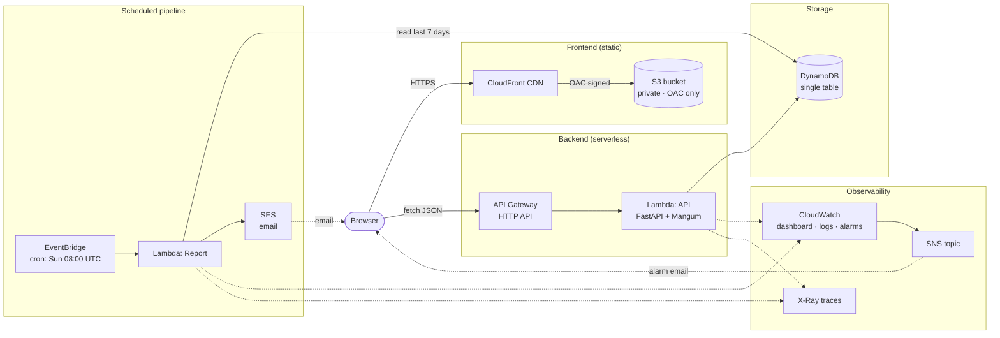

# Daily Log

A single-user study and habit tracker, built entirely on AWS serverless primitives. Terraform-managed. Deployed by GitHub Actions via OIDC. Runs inside the AWS free tier for personal use.

## What it does

Log study sessions (subject, duration, notes). Check off daily habits. Every Sunday morning, get an email summarizing the week — hours studied per subject, habit completion rates, all in one place.

## Why it exists

This is a cloud computing elective project. The point isn't the app — it's the infrastructure underneath it. The app is deliberately simple so the architecture can be the subject of the work:

- **Serverless only.** No servers, no containers, no VMs.
- **Infrastructure as Code.** Every resource is declared in Terraform. No console clicking.
- **Event-driven.** Weekly reports are triggered by EventBridge, not by a user clicking a button.
- **Observable.** Dashboard, alarms, structured JSON logs, X-Ray traces.
- **CI/CD via OIDC.** No AWS credentials stored in the repository.
- **Cost-aware.** Runs at $0 for personal use, with a documented cost model for scaling to 100k users.

## Architecture



Full component breakdown in [`docs/architecture.md`](docs/architecture.md).

## Stack

| Layer | Technology | Why |
|---|---|---|
| Compute | AWS Lambda (Python 3.12) | Pay-per-request, zero idle cost, fits the free tier |
| API | API Gateway (HTTP API) | Cheaper than REST API, simpler to configure |
| Framework | FastAPI + Mangum | Familiar locally, Lambda-compatible in production |
| Storage | DynamoDB (single table, on-demand) | No capacity planning, clean access patterns, free tier |
| Scheduling | EventBridge | Managed cron, no servers |
| Email | Amazon SES | Cheap, reliable, free tier covers this scale |
| CDN | CloudFront | Global edge caching for the frontend |
| IaC | Terraform | Everything declared, nothing clicked |
| CI/CD | GitHub Actions (OIDC) | No long-lived AWS keys in the repo |
| Observability | CloudWatch + X-Ray | Logs, metrics, traces, alarms |
| Load testing | k6 | Real numbers, not vibes |

## Deployed at

- **App:** https://d2dde2jq1dcye.cloudfront.net
- **API:** https://lcvoutxijl.execute-api.us-east-1.amazonaws.com
- **Dashboard:** [CloudWatch console](https://us-east-1.console.aws.amazon.com/cloudwatch/home?region=us-east-1#dashboards:name=dailylog-dev)

## Documentation

- [**Architecture**](docs/architecture.md) — components, data flow, and design choices
- [**Load test results**](docs/load-test-results.md) — k6 at 8 concurrent users, plus the Lambda concurrency ceiling analysis
- [**Cost model**](docs/cost-model.md) — cost at 1, 100, 10k, and 100k users
- [**OIDC postmortem**](docs/postmortem-oidc-sub-claim.md) — debugging the trust policy mismatch between GitHub Environments and AWS IAM
- [**Demo script**](docs/demo-script.md) — the video walkthrough

## Repository layout

```
dailylog/
├── backend/
│   ├── app/
│   │   ├── main.py          # FastAPI routes
│   │   ├── db.py            # DynamoDB access patterns
│   │   ├── models.py        # Pydantic models
│   │   ├── middleware.py    # Structured JSON logging
│   │   └── config.py        # env config
│   ├── report/              # Weekly report Lambda
│   ├── tests/               # pytest with moto-mocked DynamoDB
│   ├── handler.py           # API Lambda entrypoint (Mangum)
│   ├── smoke-test.sh        # End-to-end API smoke test
│   ├── build.sh             # Packages both Lambda zips
│   └── requirements.txt
├── frontend/
│   ├── index.html
│   ├── styles.css
│   ├── app.js
│   └── deploy.sh
├── terraform/               # All infrastructure
├── loadtest/
│   └── k6.js
├── docs/                    # Architecture, cost model, postmortems
└── .github/workflows/       # tests · build · deploy
```

## Data model

Single DynamoDB table, `PK = USER#me` for all items (single-user v1).

| Entity | PK | SK | Attributes |
|---|---|---|---|
| Subject | `USER#me` | `SUBJECT#<id>` | name, color, goal hours/week |
| Study session | `USER#me` | `SESSION#<date>#<id>` | subject_id, duration, notes |
| Habit | `USER#me` | `HABIT#<id>` | name, icon, active |
| Check-in | `USER#me` | `CHECKIN#<date>#<habit_id>` | completed |

**Access patterns:**

- List subjects → `begins_with(SK, "SUBJECT#")`
- Sessions in a date range → `SK BETWEEN "SESSION#<from>" AND "SESSION#<to>#zzzz"`
- Today's check-ins → `begins_with(SK, "CHECKIN#<today>")`

No GSIs, no scans. Every read is a single `query`.

## API

| Method | Path | Purpose |
|---|---|---|
| `GET` | `/health` | Health check |
| `GET` | `/subjects` | List subjects |
| `POST` | `/subjects` | Create subject |
| `GET` | `/sessions?from=&to=` | List sessions in range |
| `POST` | `/sessions` | Log a session |
| `GET` | `/habits` | List habits |
| `POST` | `/habits` | Create habit |
| `GET` | `/checkins?date=` | List check-ins for a day |
| `POST` | `/checkins` | Toggle a check-in |

## Weekly report

Every Sunday at 08:00 UTC, an EventBridge rule invokes a dedicated Lambda that:

1. Queries the last 7 days of study sessions and habit check-ins from DynamoDB
2. Renders an HTML email with study totals per subject and habit completion rates
3. Sends the email via SES

This is a separate Lambda from the API — same codebase, different function, scoped IAM role. It needs DynamoDB read + SES send, nothing else.

Test it manually:

```bash
aws lambda invoke \
  --function-name dailylog-dev-report \
  --payload '{}' \
  --cli-binary-format raw-in-base64-out \
  /tmp/report-response.json
```

## Frontend caching and security

CloudFront uses two cache strategies:

- **`index.html` and `/`** — 5-minute cache so deploys are visible quickly
- **CSS/JS assets** — 1-year immutable cache, busted by S3 ETag changes on deploy

Security posture:

- HSTS enabled with `includeSubDomains` and `preload` (1 year)
- `X-Frame-Options: DENY` (prevents clickjacking)
- `X-Content-Type-Options: nosniff` (prevents MIME sniffing)
- `Referrer-Policy: strict-origin-when-cross-origin`
- TLS 1.2 minimum enforced at the edge

Headers are attached via a CloudFront response headers policy on **all three cache behaviors** (the two ordered HTML behaviors and the default asset behavior). Attaching to only the default is a common footgun — ordered behaviors override the default, so the HTML was initially served without the headers.

Verify with:

```bash
URL=$(terraform -chdir=terraform output -raw frontend_url)
curl -sI "$URL/?v=$(date +%s)" | grep -iE 'strict-transport|x-content-type|x-frame|referrer'
```

## Observability

Operational visibility lives in CloudWatch and X-Ray.

**Dashboard:** `dailylog-dev` in the CloudWatch console shows:

- API Lambda invocations, errors, p50/p95/p99 duration
- Report Lambda invocations and errors
- DynamoDB consumed read/write capacity
- API Gateway request and 5xx counts

**Alarms:** two CloudWatch alarms push to an SNS topic that emails the project owner.

- `dailylog-dev-api-5xx` — API Gateway 5xx count > 1 for 5 minutes
- `dailylog-dev-report-errors` — report Lambda error count > 0

Both fire on ALARM and recover on OK.

**Structured logging:** the API Lambda emits one JSON line per request:

```json
{"request_id": "...", "method": "POST", "path": "/subjects", "status": 201, "duration_ms": 45.3}
```

Query recent 5xx errors in CloudWatch Logs Insights:

```
fields @timestamp, request_id, method, path, status, duration_ms
| filter status >= 500
| sort @timestamp desc
| limit 50
```

Query the slowest requests:

```
fields @timestamp, method, path, duration_ms
| filter duration_ms > 500
| sort duration_ms desc
| limit 20
```

**Tracing:** AWS X-Ray is enabled on both Lambdas. Traces include DynamoDB queries and SES calls made by the report function.

```bash
aws xray get-trace-summaries \
  --start-time $(date -u -d '5 minutes ago' +%s) \
  --end-time $(date -u +%s) \
  --query 'TraceSummaries[0:5].[Id,Duration,Http.HttpStatus]' \
  --output table
```

## Running locally

**Prerequisites:** Python 3.12+, Terraform 1.6+, AWS CLI configured, an AWS account.

```bash
# Backend: install and test
cd backend
python3.12 -m venv .venv
source .venv/bin/activate
pip install -r requirements.txt
pytest -v

# Build both Lambda packages
./build.sh

# Deploy
cd ../terraform
terraform init
terraform apply
```

Optional: run the load test.

```bash
make load
```

## Cost

Everything fits inside the AWS Always Free tier for personal use. A billing alarm fires if estimated charges exceed $1. It has never fired.

| Users | Cost/month |
|---|---|
| 1 | $0 |
| 100 | $0 |
| 10,000 | ~$32 |
| 100,000 | ~$360 |

Details in [`docs/cost-model.md`](docs/cost-model.md).

## Project log

| Day | Work | Status |
|---|---|---|
| 1 | Repo scaffold, Terraform skeleton, DynamoDB + Lambda + API Gateway deployed | ✅ |
| 2 | All endpoints verified, 11 tests passing, smoke test | ✅ |
| 3 | Frontend on S3 + CloudFront with OAC; CORS preflight fixed | ✅ |
| 4 | Habits UI, check-in toggles, weekly summary with habit completion | ✅ |
| 5 | Weekly report Lambda + EventBridge cron + SES email | ✅ |
| 6 | CloudFront cache tuning: short cache for HTML, immutable for assets, security headers, TLS 1.2 | ✅ |
| 7 | Observability: CloudWatch dashboard, alarms, structured logging, X-Ray | ✅ |
| 8 | CI/CD with GitHub Actions and OIDC; Terraform state on S3 | ✅ |
| 9 | k6 load test, cost model, OIDC postmortem | ✅ |
| 10 | Architecture diagram, architecture write-up, demo video script, README polish | ✅ |

## License

MIT — see [`LICENSE`](LICENSE).