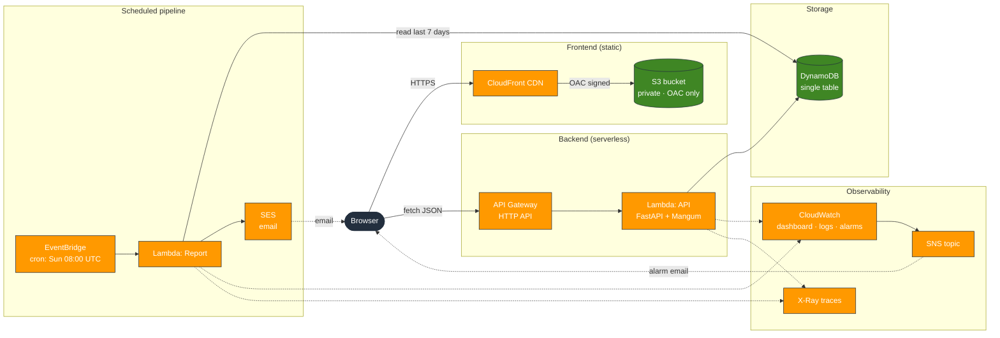

# Architecture

**Legend:** solid arrows are synchronous request paths; dashed arrows are asynchronous (logging, tracing, email).

## Overview

Daily Log is a single-user study and habit tracker. It runs entirely on AWS serverless primitives — no servers, no containers, no VMs. The whole system is defined in Terraform and deployed via GitHub Actions using OIDC.

## Component-by-component

### Frontend — S3 + CloudFront

The static frontend (HTML, CSS, vanilla JS) lives in a private S3 bucket and is served through CloudFront via **Origin Access Control**. The bucket policy only allows reads from the specific CloudFront distribution, so the assets can't be fetched directly from S3.

- **S3 bucket:** `dailylog-dev-frontend`, private, versioned, encrypted at rest
- **CloudFront:** two cache behaviors — `/` and `/index.html` use a 5-minute cache so deploys are visible quickly; CSS/JS use a 1-year immutable cache
- **Security headers:** HSTS, X-Frame-Options, X-Content-Type-Options, Referrer-Policy attached via a response headers policy
- **TLS:** minimum version 1.2 enforced at the edge

### Backend API — API Gateway + Lambda

The API is a FastAPI app packaged with Mangum and deployed as a Lambda function. API Gateway (HTTP API) fronts it.

- **API Gateway:** `$default` route forwards everything to Lambda. A dedicated `OPTIONS /{proxy+}` route handles CORS preflight without invoking the Lambda.
- **Lambda:** `dailylog-dev-api`, Python 3.12, 512 MB, 15s timeout. FastAPI handles routing, Pydantic validates request bodies, and a structured logging middleware emits one JSON line per request.
- **Cold starts:** ~1.4s init duration on the first request after idle. Warm requests run in 5–100ms.

### Storage — DynamoDB

All application data lives in a single DynamoDB table, `dailylog-dev`. Every item has `PK = USER#me` and an `SK` that encodes the entity type:

| Entity | SK format |
|---|---|
| Subject | `SUBJECT#<id>` |
| Study session | `SESSION#<date>#<id>` |
| Habit | `HABIT#<id>` |
| Check-in | `CHECKIN#<date>#<habit_id>` |

This design keeps every access pattern on a single partition (fast, cheap), enables range queries by date (e.g., "last 7 days of sessions"), and avoids secondary indexes entirely.

- **Billing mode:** on-demand — no capacity planning, scales to zero when idle
- **Point-in-time recovery:** enabled
- **Data retention:** unlimited (v1 has no cleanup yet)

### Weekly report — EventBridge + Lambda + SES

A second Lambda function generates the weekly email.

- **Trigger:** EventBridge scheduled rule, `cron(0 8 ? * SUN *)` (every Sunday at 08:00 UTC)
- **Function:** `dailylog-dev-report`, Python 3.12, 256 MB, 30s timeout
- **Logic:** queries the last 7 days of sessions and check-ins, aggregates by subject and habit, renders an HTML email, sends via SES
- **Email:** sent to the verified SES identity configured in `terraform.tfvars`
- **IAM:** scoped to `dynamodb:GetItem`, `dynamodb:Query`, and `ses:SendEmail` — nothing else

### Scheduled trigger — EventBridge

A single rule fires the report Lambda weekly. The rule is defined in Terraform so the schedule is versioned alongside the code.

### Email — SES

SES is in sandbox mode — verified sender and verified recipient. For a real production service you'd request production access, which removes the sandbox restriction and enables sending to arbitrary recipients.

## Data flow — writing a study session

1. Browser sends `POST /sessions` with `{ subject_id, duration_min, notes }`
2. CloudFront passes the request through to API Gateway
3. API Gateway forwards to the API Lambda
4. FastAPI validates the body with Pydantic
5. `db.create_session()` writes an item with `SK = SESSION#<date>#<uuid>` to DynamoDB
6. Lambda returns 201 with the created session
7. The response flows back through API Gateway and CloudFront to the browser
8. In parallel, the structured logging middleware emits a JSON log line to CloudWatch Logs

## Data flow — weekly email

1. EventBridge fires the `dailylog-dev-weekly` rule at 08:00 UTC Sunday
2. EventBridge invokes the report Lambda
3. Lambda queries DynamoDB for:
    - All subjects and habits (to build display names)
    - All sessions in the last 7 days
    - All check-ins in the last 7 days
4. Lambda aggregates totals per subject and completion counts per habit
5. Lambda renders an HTML email
6. Lambda calls SES `SendEmail`
7. SES delivers the email to the verified recipient
8. Lambda logs and returns `{"status": "ok"}`

## Observability

- **CloudWatch dashboard** `dailylog-dev` shows Lambda invocations, errors, and duration percentiles; DynamoDB consumed capacity; API Gateway 5xx counts
- **Two alarms** push to an SNS topic that emails the owner: API 5xx rate > 1 for 5 minutes, and report Lambda error count > 0
- **Structured JSON logging** from the API Lambda — one line per request with `request_id`, `method`, `path`, `status`, `duration_ms`. Queryable in Logs Insights.
- **X-Ray tracing** enabled on both Lambdas

## Deployment

Everything is deployed by GitHub Actions on push to `main`. The workflow:

1. Assumes the `dailylog-dev-github-deploy` IAM role via **OIDC** (no AWS access keys stored anywhere)
2. Runs the pytest suite
3. Builds both Lambda packages
4. Runs `terraform apply` against the S3-hosted state backend
5. Syncs the frontend to S3 and invalidates CloudFront
6. Smoke-tests the deployed API

## Infrastructure as Code

All resources are managed by Terraform. The state lives in `s3://dailylog-terraform-state-949847740139/dev/terraform.tfstate`.

| File | Contents |
|---|---|
| `main.tf` | Provider, backend |
| `variables.tf` | Variables (`project`, `stage`, `aws_region`, `report_*`) |
| `dynamodb.tf` | Table definition |
| `lambda.tf` | API Lambda |
| `report.tf` | Report Lambda + IAM + EventBridge |
| `iam.tf` | API Lambda role and policy |
| `apigateway.tf` | HTTP API, route, CORS, Lambda permission |
| `frontend.tf` | S3 bucket, CloudFront distribution, OAC, security headers |
| `dashboard.tf` | CloudWatch dashboard |
| `alarms.tf` | Two alarms + SNS topic |
| `github_oidc.tf` | GitHub OIDC provider + deploy role |
| `outputs.tf` | Output values |

## Why these choices

- **Lambda over containers:** the app has bursty, low-volume traffic. Lambda's pay-per-request model means $0 when idle. A container on ECS would cost $15+/month minimum.
- **DynamoDB over RDS:** the access patterns are simple key-value and range queries. DynamoDB's on-demand pricing means no capacity planning and no idle cost.
- **HTTP API over REST API:** ~70% cheaper, simpler to configure. REST API's extra features aren't needed here.
- **API Gateway CORS + dedicated OPTIONS route:** HTTP APIs support CORS natively, but a `$default` route catches OPTIONS before the built-in CORS handler runs. Adding an explicit `OPTIONS /{proxy+}` route pointing at Lambda solves it.
- **Two Lambdas instead of one:** the report Lambda has a different shape from the API Lambda — different deps, different IAM, different invocation pattern. Splitting keeps each function small and scoped.
- **OIDC over long-lived AWS keys in GitHub Secrets:** nothing to rotate, nothing to leak. The role is scoped to `repo:KallieKay@…/dailylog@…:environment:production`.